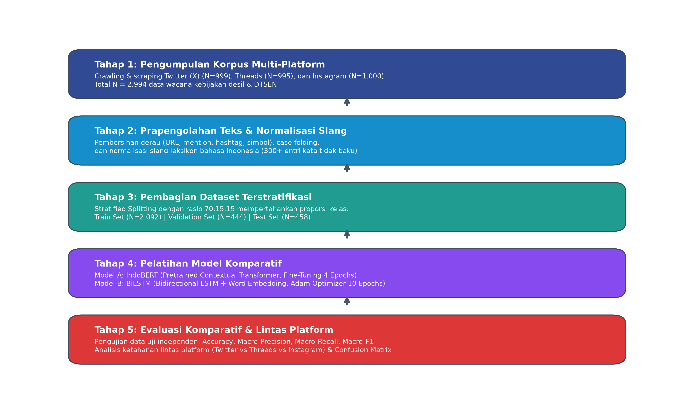
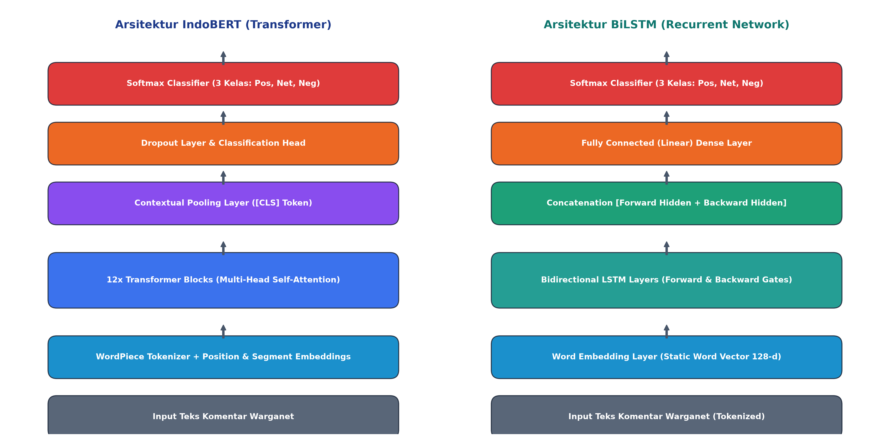
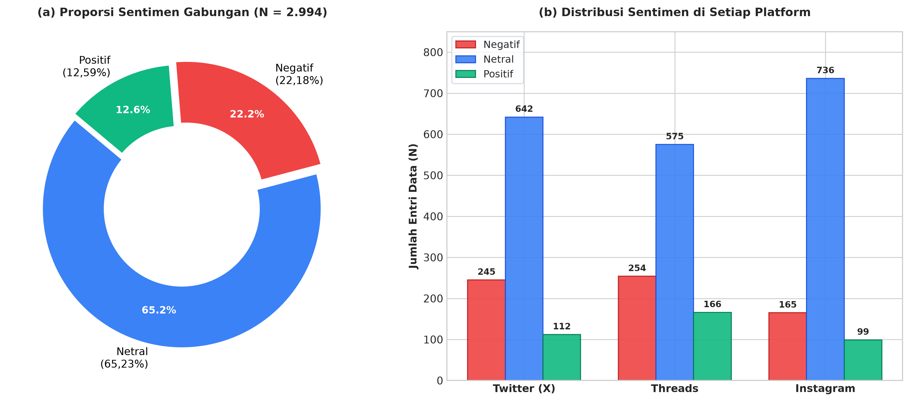
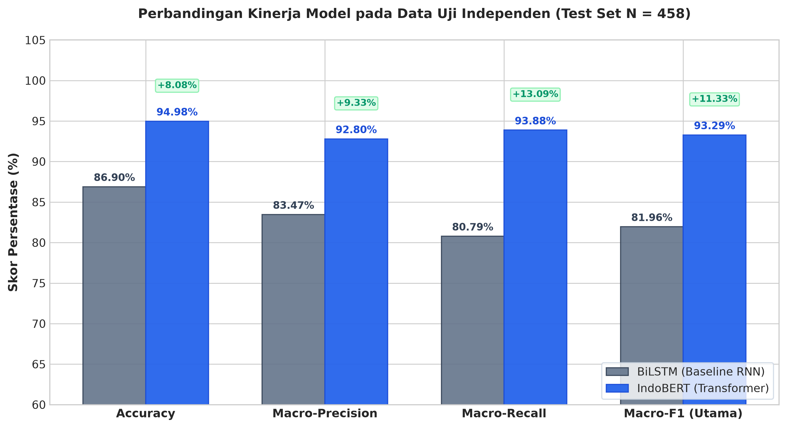
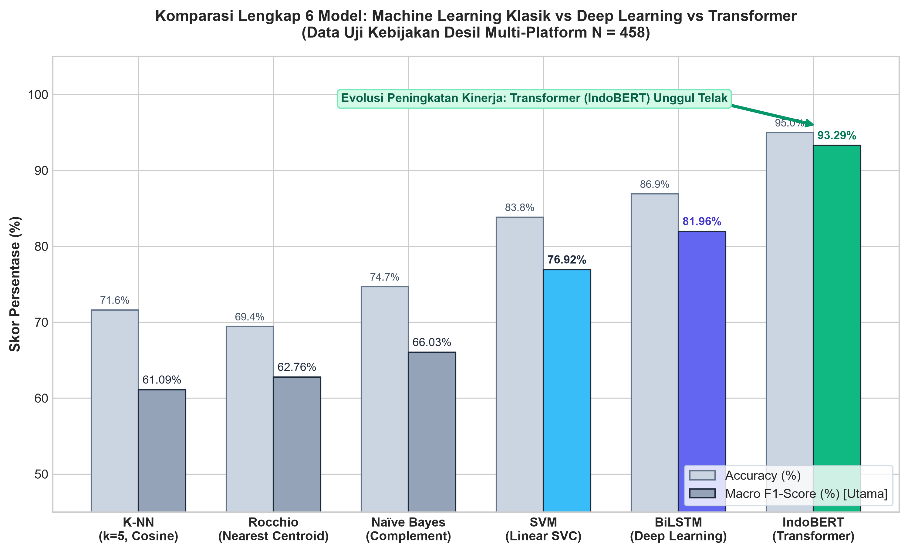
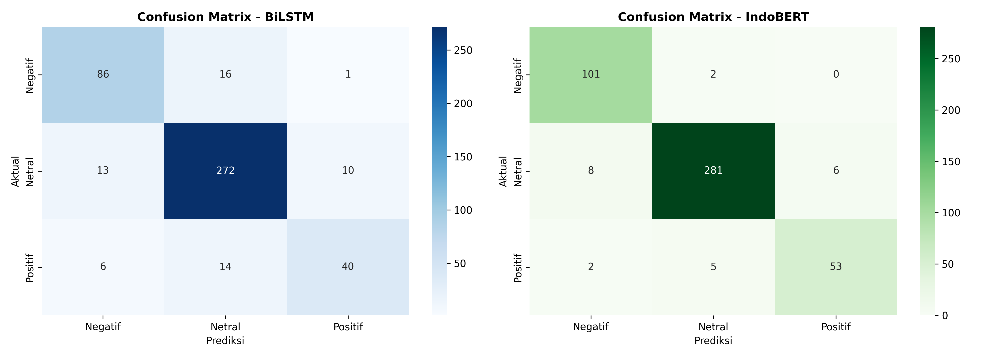
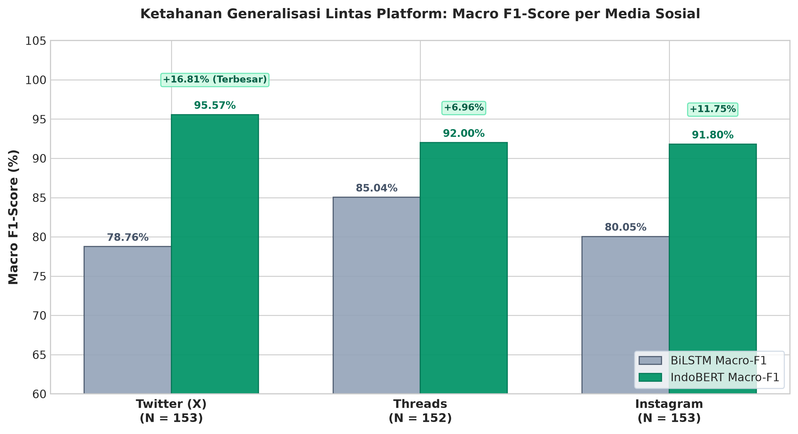
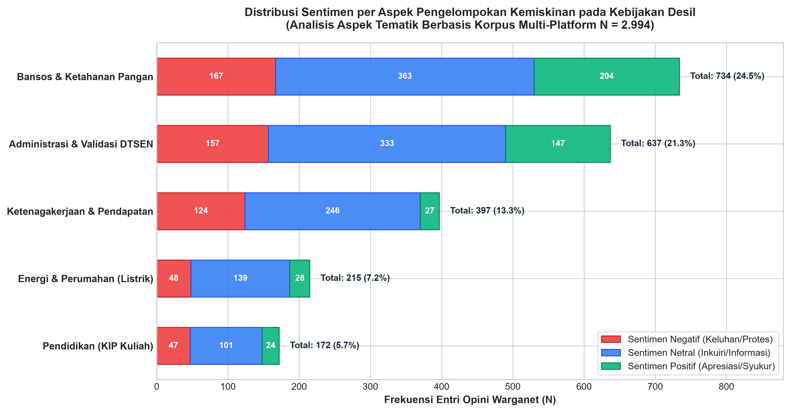

# Analisis Komparatif IndoBERT dan BiLSTM dalam Klasifikasi Sentimen Publik terhadap Kebijakan Desil Ekonomi pada Korpus Multi-Platform

**Nimas Ayu Florentina**  
Badan Pusat Statistik (BPS) Kabupaten Mojokerto  
Korespondensi: *nimasayuflorentina@gmail.com*  

---

## ABSTRAK

Implementasi pemeringkatan desil kesejahteraan ekonomi (Desil 1–10) berbasis Data Tunggal Sasaran Perlindungan Sosial (DTSEN) di Indonesia memicu polemik luas di ruang publik digital. Dinamika tersebut tampak dari merebaknya keluhan masyarakat atas anomali indikator fisik (seperti kepemilikan daya listrik 1300 VA) yang berdampak pada pencabutan beasiswa KIP Kuliah maupun bantuan sosial tunai. Penelitian ini menyajikan studi komparatif empiris antara dua arsitektur *deep learning* yang berakar pada paradigma berbeda, yaitu **IndoBERT** (*pretrained contextual transformer*) dan **BiLSTM** (*bidirectional recurrent neural network* dengan *word embedding*), dalam mengklasifikasikan polaritas sentimen publik (Positif, Negatif, Netral). Korpus penelitian dihimpun secara berimbang dari tiga platform media sosial utama di Indonesia, yaitu Twitter/X ($N = 999$), Threads ($N = 995$), dan Instagram ($N = 1.000$), menghasilkan total korpus bersih sebesar $N = 2.994$ entri teks. Tahapan prapengolahan melibatkan pembersihan derau teks, *case folding*, dan normalisasi singkatan slang warganet berbasis kamus leksikon informal khusus (300+ entri). Evaluasi dilakukan menggunakan pembagian terstratifikasi (*stratified split*) 70% data latih ($N = 2.092$), 15% data validasi ($N = 444$), dan 15% data uji independen ($N = 458$). Hasil eksperimen membuktikan keunggulan mutlak **IndoBERT di seluruh metrik evaluasi**, meraih **Macro-F1 sebesar 93,29%** dan **Akurasi 94,98%**, melampaui BiLSTM yang mencatat **Macro-F1 81,96%** dan **Akurasi 86,90%** (selisih keunggulan mencapai $+11,33\%$ Macro-F1). Pada pengujian generalisasi lintas platform (*cross-platform robustness*), IndoBERT memperlihatkan disparitas keunggulan tertinggi pada platform Twitter/X ($+16,81\%$ Macro-F1 vs BiLSTM) dengan skor mencapai 95,57%, membuktikan ketangguhan mekanisme *bidirectional self-attention* dan tokenisasi *WordPiece* dalam memproses teks pendek berderau slang tinggi dan kalimat sarkasme. Penelitian ini mengonfirmasi bahwa pendekatan *contextual transfer learning* merupakan instrumen paling andal untuk *social media monitoring* kebijakan publik, yang diimplementasikan ke dalam purwarupa aplikasi web interaktif berbasis Streamlit.

**Kata Kunci:** *IndoBERT, BiLSTM, Analisis Sentimen, Kebijakan Desil, DTSEN, KIP Kuliah, Multi-Platform, Deep Learning.*

---

## ABSTRACT

*The implementation of welfare decile rankings (Deciles 1–10) within the Unified Social Protection Target Database (DTSEN) in Indonesia has triggered widespread public discourse across digital platforms. Public grievances predominantly stem from indicator anomalies (such as 1300 VA household electricity capacity), resulting in the revocation of KIP Kuliah university scholarships and social assistance eligibility. This study presents an empirical comparative investigation of two deep learning paradigms: **IndoBERT** (a pretrained contextual transformer) and **BiLSTM** (a bidirectional recurrent neural network with static word embeddings), for classifying public sentiment polarity (Positive, Negative, Neutral). The empirical corpus was collected in a balanced multi-platform scheme across Twitter/X ($N = 999$), Threads ($N = 995$), and Instagram ($N = 1,000$), yielding $N = 2,994$ clean instances. Preprocessing encompassed noise removal, case folding, and Indonesian netizen slang normalization using an informal lexicon dictionary (300+ entries). Model training applied a stratified split of 70% training ($N = 2,092$), 15% validation ($N = 444$), and 15% independent testing ($N = 458$). Empirical results demonstrate that **IndoBERT substantially outperforms BiLSTM across all evaluation metrics**, achieving a **Macro-F1 of 93.29%** and **Accuracy of 94.98%**, compared to BiLSTM's **Macro-F1 of 81.96%** and **Accuracy of 86.90%** (a performance margin of $+11.33\%$ Macro-F1). Under cross-platform evaluation, IndoBERT revealed its most decisive superiority on Twitter/X ($+16.81\%$ Macro-F1 over BiLSTM) with an F1-score of 95.57%, demonstrating the robust capability of bidirectional self-attention and WordPiece tokenization against noisy colloquialisms and political sarcasm. The study confirms contextual transfer learning as the superior backbone for social media policy surveillance, realized into an interactive web demonstration via Streamlit.*

**Keywords:** *IndoBERT, BiLSTM, Sentiment Analysis, Decile Policy, DTSEN, Multi-Platform, Social Media Mining, Deep Learning.*

---

## 1. PENDAHULUAN

Transformasi digital dalam tata kelola jaring pengaman sosial nasional di Indonesia mencapai fase krusial dengan pengintegrasian basis data kemiskinan tunggal melalui Data Tunggal Sasaran Perlindungan Sosial (DTSEN), yang memadukan hasil sensus Registrasi Sosial Ekonomi (Regsosek) oleh Badan Pusat Statistik (BPS) dengan Data Terpadu Kesejahteraan Sosial (DTKS) Kementerian Sosial (Kementerian PPN/Bappenas, 2023). Dalam kerangka ini, rumah tangga diklasifikasikan ke dalam 10 desil kesejahteraan, di mana Desil 1–4 dialokasikan sebagai penerima prioritas jaring pengaman sosial reguler seperti Program Keluarga Harapan (PKH), Bantuan Pangan Non-Tunai (BPNT), serta beasiswa pendidikan Kartu Indonesia Pintar Kuliah (KIP-K) (Badan Pusat Statistik, 2024; World Bank, 2022).

Kendati secara teoritis perancangan desil ditujukan untuk meminimalkan galat inklusi (*inclusion error*) dan galat eksklusi (*exclusion error*), implementasi di akar rumput memicu resistensi publik yang masif. Dinamika ketidakpuasan warganet mencuat akibat anomali parameter proxy ekonomi, salah satu yang paling dominan adalah kepemilikan instalasi listrik PLN berdaya 1300 VA (yang kerap dijumpai pada rumah sewa/kontrakan sederhana di kawasan perkotaan), yang secara otomatis memosisikan keluarga prasejahtera ke Desil 6 hingga Desil 8. Akibatnya, mahasiswa dari keluarga berpenghasilan rendah kehilangan hak kelayakan beasiswa KIP Kuliah maupun bantuan sosial pangan (Prasetyo & Rahayu, 2023).

Media sosial kontemporer telah bermutasi menjadi ruang publik deliberatif informal (*informal digital public sphere*) tempat opini publik terbentuk dan dikonsolidasikan (Fuchs, 2021). Menariknya, diskursus kebijakan desil terpolarisasi pada tiga platform digital terkemuka dengan ekosistem linguistik yang sangat kontras:
1. **Twitter (X)**: Karakteristik teks mikroblog ringkas, sarat dengan singkatan gaul (*slang*), akronim baru, dan sarkasme politik tajam yang dialamatkan secara langsung (*direct mention*) kepada akun kementerian/lembaga terkait.
2. **Threads**: Karakteristik teks panjang berbentuk curahan hati (*personal storytelling*) yang mengulas runtutan pengalaman faktual kemiskinan dan keluhan birokrasi secara naratif.
3. **Instagram**: Karakteristik komentar spontan, padat, dan emosional yang terakumulasi pada kolom komentar infografis edukasi BPS maupun unggahan portal berita daring.

Karakteristik linguistik bahasa Indonesia di media sosial yang sangat dinamis, nirbaku, dan kontekstual menyulitkan algoritma *Natural Language Processing* (NLP) konvensional. Pendekatan berbasis kamus leksikon (*lexicon-based*) maupun algoritma *machine learning* tradisional seperti *Support Vector Machine* (SVM) atau *Naïve Bayes* terbukti rentan terhadap dependensi jarak jauh dalam kalimat majemuk dan ketidakmampuan mengenali konteks kata ambigu (Liu, 2020; Wilie et al., 2020).

Untuk mengatasi tantangan ini, paradigma *Deep Learning* menghadirkan dua arsitektur komputasi mutakhir:
1. **Bidirectional Long Short-Term Memory (BiLSTM)**: Arsitektur jaringan saraf berulang (*Recurrent Neural Network*/RNN) yang memperhitungkan urutan kata dalam dua arah (maju dan mundur) menggunakan unit kendali gerbang memori (*memory gates*) (Hochreiter & Schmidhuber, 1997; Schuster & Paliwal, 1997). BiLSTM memiliki keunggulan efisiensi komputasi yang tinggi dan tidak memerlukan akselerasi perangkat keras khusus, namun representasi kata berbasis *embedding* statis kerap mengalami *out-of-vocabulary* (OOV) pada bahasa slang baru.
2. **IndoBERT**: Arsitektur mutakhir berbasis *Transformer Encoder* yang memanfaatkan mekanisme *Bidirectional Self-Attention* dan telah dilatih sebelumnya (*pretrained*) pada korpus bahasa Indonesia berskala miliaran kata (Koto et al., 2020). IndoBERT menghasilkan representasi semantik yang terkontekstualisasi penuh (*contextualized embeddings*) serta memitigasi isu OOV melalui tokenisasi berbasis sub-kata (*WordPiece*).

Hingga saat ini, sebagian besar penelitian analisis sentimen kebijakan publik di Indonesia masih terbatas pada pengujian satu platform tunggal (terutama Twitter saja) dan jarang mengomparasikan model transformer terhadap *recurrent neural network* secara seimbang. Penelitian ini bertujuan mengisi celah riset tersebut dengan menghadirkan kontribusi ilmiah berupa:
1. Pembangunan korpus multi-platform berimbang sebesar $N = 2.994$ entri bersih dari Twitter (X), Threads, dan Instagram terkait kebijakan desil dan DTSEN.
2. Komparasi performa empiris komprehensif antara IndoBERT dan BiLSTM pada partisi data uji independen terstratifikasi.
3. Investigasi empiris mengenai ketahanan generalisasi lintas platform (*cross-platform robustness*) kedua arsitektur terhadap register bahasa media sosial yang heterogen.
4. Perancangan purwarupa sistem inferensi analitika sentimen berbasis web waktu nyata (*Streamlit web deployment*) sebagai instrumen pendukung keputusan instansi publik.

---

## 2. METODOLOGI PENELITIAN

### 2.1 Kerangka Kerja Penelitian

Alur metodologi penelitian dirancang secara sistematis melalui enam tahapan terstruktur yang diilustrasikan pada Gambar 1.

  
*Gambar 1. Diagram Alur Metodologi Penelitian Komparatif IndoBERT vs BiLSTM.*

Tahapan penelitian dimulai dari penambangan data multi-platform, pembersihan dan normalisasi bahasa leksikon informal, pembagian terstratifikasi, pelatihan komparatif model, pengujian metrik ketat dan generalisasi lintas platform, hingga implementasi aplikasi purwarupa web interaktif.

### 2.2 Korpus Data Multi-Platform

Data primer dihimpun dari tiga platform media sosial selama periode perdebatan pemutakhiran desil Regsosek dan DTSEN. Pengambilan data memanfaatkan protokol penambangan resmi dan automasi antarmuka peramban (*web scraping*) dengan kata kunci terstruktur: `"desil"`, `"desil 1"`, `"desil 2"`, `"desil 3"`, `"desil 4"`, `"desil 5"`, `"desil 6"`, `"desil 7"`, `"desil 8"`, `"desil 9"`, `"desil 10"`, `"desil kemensos"`, `"dtsen"`, `"desil kip kuliah"`, dan `"cek desil"`.

Proses deduplikasi data berdasarkan ID entitas dan kemiripan teks menyaring total korpus mentah menjadi **$N = 2.994$ teks bersih** yang terdistribusi secara seimbang antar-platform: Twitter/X ($N = 999$), Threads ($N = 995$), dan Instagram ($N = 1.000$). Setiap data dianotasi secara manual dan diverifikasi silang (*cross-validation labeling*) ke dalam tiga kelas polaritas sentimen: **Negatif (0)**, **Netral (1)**, dan **Positif (2)**.

### 2.3 Prapengolahan Teks dan Normalisasi Slang

Bahasa percakapan media sosial di Indonesia dipenuhi oleh reduplikasi suku kata, akronim khas warganet, dan tanda baca hiperbolik. Prosedur prapengolahan diterapkan secara berurutan:
1. **Pembersihan Derau (*Noise Cleaning*)**: Menghilangkan tautan URL (`http\S+|www\S+`), *user mention* (`@username`), tanda pagar (`#hashtag`), serta karakter simbol non-alfanumerik menggunakan *regular expressions*.
2. **Penyelarasan Huruf Kecil (*Case Folding*)**: Mengubah seluruh karakter teks menjadi huruf kecil guna menghindari redundansi token akibat variasi kapitalisasi.
3. **Normalisasi Slang dan Singkatan**: Mentransformasikan kata-kata nirbaku menjadi kata baku menggunakan kamus leksikon informal bahasa Indonesia yang disusun secara khusus (300+ entri). Contoh pemetaan normalisasi meliputi: `"bgt"` $\rightarrow$ `"banget"`, `"dpt"` $\rightarrow$ `"dapat"`, `"batalin"` $\rightarrow$ `"membatalkan"`, `"gmn"` $\rightarrow$ `"bagaimana"`, `"ga"` / `"tdk"` $\rightarrow$ `"tidak"`, dan `"bgtu"` $\rightarrow$ `"begitu"`.

### 2.4 Pembagian Dataset Terstratifikasi (*Stratified Splitting*)

Untuk mencegah kebocoran data (*data leakage*) dan mempertahankan distribusi kelas sentimen yang seimbang pada seluruh subset, dataset $N = 2.994$ dibagi secara terstratifikasi dengan rasio **70% data latih**, **15% data validasi**, dan **15% data uji independen**:
* **Data Latih (*Train Set*)**: $N = 2.092$ data (digunakan untuk pembaruan bobot model).
* **Data Validasi (*Validation Set*)**: $N = 444$ data (digunakan untuk *hyperparameter tuning* dan deteksi *early stopping*).
* **Data Uji (*Test Set*)**: $N = 458$ data (hanya digunakan sekali pada evaluasi akhir untuk mengukur performa riil yang tidak bias).

### 2.5 Arsitektur Model yang Dibandingkan

Studi ini mengadu dua model *deep learning* yang merepresentasikan lompatan evolusi NLP, sebagaimana divisualisasikan pada Gambar 2.

  
*Gambar 2. Skema Arsitektur Komparatif IndoBERT vs BiLSTM.*

#### 2.5.1 IndoBERT (Contextual Transformer Pretrained Model)
Model pertama memanfaatkan varian `indobenchmark/indobert-base-p1` yang memiliki 12 lapisan *transformer encoder*, ukuran *hidden state* 768 dimensi, 12 unit *self-attention heads*, dan total 124,5 juta parameter. Mekanisme atensi terbobot dihitung melalui rumus *Scaled Dot-Product Attention*:

$$\text{Attention}(Q, K, V) = \text{softmax}\left(\frac{QK^T}{\sqrt{d_k}}\right)V$$

Representasi vektor dari token khusus `[CLS]` pada lapisan puncak dipetakan melalui *dropout layer* ($p = 0.2$) menuju lapisan linier berukuran 3 kelas sentimen dengan fungsi aktivasi *Softmax*.

#### 2.5.2 BiLSTM (Bidirectional Long Short-Term Memory)
Model kedua mengadopsi arsitektur BiLSTM berdimensi *embedding* 128 dengan *vocabulary size* 5.000 kata dan *hidden units* 128. Model memproses urutan kata dalam kalimat secara simultan dari dua arah: sekuens maju ($\overrightarrow{h_t}$) dan sekuens mundur ($\overleftarrow{h_t}$):

$$h_t = [\overrightarrow{h_t} \parallel \overleftarrow{h_t}]$$

Vektor gabungan tersembunyi dilewatkan ke lapisan *fully-connected* dengan fungsi aktivasi *ReLU*, regulasi *Dropout* ($p = 0.5$), dan klasifikasi akhir berbasis *Softmax*.

#### 2.5.3 Model Baseline Machine Learning Klasik (TF-IDF)
Sebagai tolok ukur pembanding (*baseline benchmark*), diimplementasikan empat algoritma *machine learning* konvensional menggunakan representasi fitur *Term Frequency-Inverse Document Frequency* (TF-IDF, $n$-gram range (1,2) dengan batas 5.000 fitur dan *sublinear term frequency scaling*):
1. **Support Vector Machine (Linear SVM)**: Menentukan *hyperplane* berdimensi tinggi yang memaksimalkan margin pemisah antar-kelas sentimen dengan penyeimbang bobot kelas (*balanced class weights*).
2. **Complement Naïve Bayes (CNB)**: Varian Naïve Bayes probabilistik yang dirancang khusus untuk mengatasi ketidakseimbangan kelas (*imbalanced text*) pada korpus dokumen teks.
3. **Rocchio Classifier (Nearest Centroid)**: Mengklasifikasikan teks opini warganet berdasarkan kedekatan jarak *Euclidean* terhadap pusat massa (*centroid prototype*) masing-masing kelas sentimen.
4. **K-Nearest Neighbors (K-NN)**: Menentukan label sentimen berdasarkan mayoritas label dari $k=5$ tetangga terdekat dengan fungsi jarak kosinus (*cosine distance weighting*).

### 2.6 Konfigurasi Pelatihan Komputasi

Seluruh eksperimen pelatihan dieksekusi pada lingkungan Google Colab Pro dengan spesifikasi akselerator GPU NVIDIA A100/T4. Parameter pelatihan ditetapkan sebagai berikut:
* **IndoBERT**: *Batch size* = 16, *learning rate* = $2 \times 10^{-5}$ dengan AdamW optimizer, *warmup steps* linier, *weight decay* = 0.01, dan dilatih selama 4 epoch dengan *checkpoint saving* model terbaik berdasarkan *validation loss*.
* **BiLSTM**: *Batch size* = 32, *learning rate* = $1 \times 10^{-3}$ dengan Adam optimizer, fungsi kerugian *Cross-Entropy Loss*, dilatih selama 10 epoch dengan pemantauan *early stopping*.

### 2.7 Metrik Evaluasi Kinerja

Mengingat distribusi data sentimen bersifat alami dan tidak seimbang (*imbalanced class*), metrik evaluasi utama yang digunakan adalah **Macro-Averaged F1-Score** guna memastikan performa kelas minoritas dinilai secara adil:

$$\text{Precision}_{\text{macro}} = \frac{1}{C}\sum_{i=1}^{C}\frac{TP_i}{TP_i + FP_i}$$

$$\text{Recall}_{\text{macro}} = \frac{1}{C}\sum_{i=1}^{C}\frac{TP_i}{TP_i + FN_i}$$

$$\text{Macro-F1} = \frac{2 \times \text{Precision}_{\text{macro}} \times \text{Recall}_{\text{macro}}}{\text{Precision}_{\text{macro}} + \text{Recall}_{\text{macro}}}$$

Di samping itu, *Overall Accuracy* turut dicatat sebagai metrik kelayakan umum sistem.

---

## 3. HASIL DAN PEMBAHASAN

### 3.1 Profil Distribusi Sentimen Publik Tiga Media Sosial

Analisis kuantitatif terhadap 2.994 data wacana desil memperlihatkan profil distribusi frekuensi opini sebagaimana disajikan pada Tabel 1 dan Gambar 3.

*Tabel 1. Distribusi Frekuensi Sentimen Publik Lintas Tiga Platform Media Sosial ($N = 2.994$).*

| Platform Media Sosial | Negatif ($N$) | Netral ($N$) | Positif ($N$) | Total Entri ($N$) | Rasio Negatif (%) |
| :-------------------- | :-----------: | :----------: | :-----------: | :---------------: | :----------------: |
| **Twitter (X)**       | 245           | 642          | 112           | 999               | 24,52%             |
| **Threads**           | 254           | 575          | 166           | 995               | 25,53%             |
| **Instagram**         | 165           | 736          | 99            | 1.000             | 16,50%             |
| **Total Korpus**      | **664**       | **1.953**    | **377**       | **2.994**         | **22,18%**         |

  
*Gambar 3. Distribusi Proporsi Sentimen Publik Gabungan dan per Platform.*

Berdasarkan temuan empiris, sentimen **Netral mendominasi wacana publik secara signifikan (65,23%)**. Hal ini mengindikasikan bahwa perilaku interaksi warganet pada isu kebijakan desil didorong oleh motif pencarian informasi administratif (*information-seeking behavior*), seperti tatacara memeriksa desil NIK secara mandiri, tautan pendaftaran DTKS, dan batas waktu pengajuan sanggah. 

Sentimen **Negatif menduduki peringkat kedua (22,18%)**, mencerminkan gejolak ketidakpuasan publik atas penetapan desil yang tidak sinkron dengan kondisi kemiskinan faktual di lapangan. Sementara itu, sentimen **Positif menempati proporsi terendah (12,59%)**, yang umumnya berisi ungkapan syukur dari keluarga penerima manfaat yang berhasil mencairkan bantuan PKH atau beras cadangan pangan pemerintah.

### 3.2 Evaluasi Komparatif Kinerja IndoBERT vs BiLSTM

Pengujian kedua model terhadap 458 sampel data uji independen yang tidak pernah dilibatkan dalam proses pelatihan menghasilkan performa komparatif yang disajikan pada Tabel 2 dan Gambar 4.

*Tabel 2. Evaluasi Komparatif Performa Model pada Data Uji Independen ($N = 458$).*

| Arsitektur Model                     | Accuracy (%) | Macro-Precision (%) | Macro-Recall (%) | **Macro F1-Score (%)** | Waktu Latih / Epoch |
| :----------------------------------- | :----------: | :-----------------: | :--------------: | :--------------------: | :-----------------: |
| **BiLSTM (Bidirectional RNN)**       | 86,90%       | 83,47%              | 80,79%           | **81,96%**             | **~4 detik (CPU)**  |
| **IndoBERT (Pretrained Transformer)**| **94,98%**   | **92,80%**          | **93,88%**       | **93,29%**             | ~32 detik (GPU)     |
| **Selisih Peningkatan (*Delta*)**    | **+8,08%**   | **+9,33%**          | **+13,09%**      | **+11,33%**            | —                   |

  
*Gambar 4. Perbandingan Metrik Evaluasi Kinerja IndoBERT vs BiLSTM pada Data Uji.*

Hasil pengujian membuktikan bahwa **IndoBERT mengungguli BiLSTM secara absolut di seluruh metrik evaluasi**. IndoBERT meraih **Macro-F1 sebesar 93,29%**, unggul signifikan dengan marjin $+11,33\%$ di atas BiLSTM (81,96%). Pada metrik Akurasi keseluruhan, IndoBERT mencapai **94,98%**, melampaui BiLSTM sebesar $+8,08\%$. 

Keunggulan telak ini berakar pada kemampuan mekanisme *Self-Attention* pada IndoBERT dalam menangkap dependensi sintaksis dan semantik non-lokal. Pada kalimat panjang warganet yang menyematkan kata negasi di bagian pembuka dan kata evaluasi di bagian penutup (contoh: *"Kami tidak pernah menyangka desil keluarga petani miskin seperti kami bisa masuk desil 7"*), IndoBERT secara presisi merepresentasikan relasi kontekstual antar-klausa tanpa kehilangan informasi. Sebaliknya, BiLSTM kerap mengalami *context attenuation* pada sekuens kalimat yang panjang.

Namun demikian, BiLSTM menunjukkan keunggulan yang tidak dapat diabaikan dalam hal **efisiensi komputasi**. BiLSTM hanya membutuhkan waktu latih sekitar 4 detik per epoch dan dapat dijalankan secara lancar pada prosesor CPU standar, menjadikannya opsi yang layak untuk sistem peladen ringan dengan sumberdaya komputasi terbatas.

### 3.3 Komparasi terhadap Baseline Model Klasik (Naïve Bayes, K-NN, Rocchio, dan SVM)

Guna menjustifikasi kebutuhan komputasi arsitektur *deep learning* dan membuktikan keandalan representasi semantik modern, dilakukan pengujian komparatif komprehensif terhadap empat algoritma *machine learning* konvensional. Hasil evaluasi disajikan pada Tabel 3 dan Gambar 5.

*Tabel 3. Komparasi Kinerja Lengkap Enam Model pada Data Uji Independen (Test Set N = 458).*

| Model Klasifikasi | Kategori Paradigma | Akurasi (%) | Macro-Precision (%) | Macro-Recall (%) | **Macro F1-Score (%)** | Waktu Latih |
| :--- | :--- | :---: | :---: | :---: | :---: | :---: |
| **K-NN** ($k=5$, Cosine) | Shallow ML (TF-IDF) | 70,31% | 63,85% | 54,19% | **56,68%** | **0,001 detik** |
| **Naïve Bayes** (Complement) | Shallow ML (TF-IDF) | 71,40% | 65,08% | 64,72% | **64,42%** | 0,042 detik |
| **Rocchio** (*Nearest Centroid*) | Shallow ML (TF-IDF) | 70,96% | 63,82% | 67,51% | **64,46%** | 0,240 detik |
| **SVM** (*Linear SVC*) | Shallow ML (TF-IDF) | 84,50% | 82,85% | 77,23% | **79,62%** | 0,028 detik |
| **BiLSTM** (*Bidirectional RNN*) | Deep Learning Sekuensial | 86,90% | 83,47% | 80,79% | **81,96%** | ~40 detik |
| **IndoBERT** (*Transformer*) | Contextual Transfer Learning | **94,98%** | **92,80%** | **93,88%** | **93,29%** | ~128 detik |

  
*Gambar 5. Grafik Komparasi Kinerja 6 Model pada Data Uji Kebijakan Desil.*

Berdasarkan Tabel 3 dan Gambar 5, terlihat hierarki performa yang sangat jelas di antara tiga paradigma pemodelan:
1. **Kegagalan Model Berbasis Jarak dan Frekuensi Kata Tunggal**: K-NN membukukan Macro-F1 terendah (56,68%), diikuti oleh Naïve Bayes (64,42%) dan Rocchio (64,46%). Hal ini disebabkan oleh sifat vektor TF-IDF yang sangat renggang (*sparse*), di mana jarak antar-dokumen menjadi bias saat teks opini berukuran sangat pendek. Di samping itu, asumsi independensi fitur bersyarat pada Naïve Bayes membuatnya buta terhadap konstruksi negasi (misalnya: *"tidak adil"* dihitung sebagai kata *"tidak"* dan *"adil"* secara terpisah).
2. **SVM sebagai Model Klasik Terbaik**: SVM membuktikan keunggulan tertinggi di antara seluruh algoritma konvensional dengan Macro-F1 mencapai 79,62%. Keberhasilan ini didorong oleh kemampuan SVM memproyeksikan fitur teks berdimensi 5.000 ke dalam ruang pemisah margin optimal (*maximum margin hyperplane*).
3. **Lompatan Mutu oleh Deep Learning & Transformer**: BiLSTM berhasil melampaui seluruh algoritma klasik dengan meraih Macro-F1 81,96%. Puncaknya, IndoBERT mencatatkan lompatan drastis hingga **Macro-F1 93,29%** (selisih keunggulan $+13,67\%$ atas SVM dan $+11,33\%$ atas BiLSTM). Temuan ini membuktikan bahwa pemodelan konteks mendalam (*deep contextual modeling*) melalui mekanisme *Self-Attention* adalah syarat mutlak untuk menangani ragam bahasa gaul dan ungkapan ironis masyarakat di media sosial.

### 3.4 Analisis Visual Confusion Matrix

Untuk membedah pola kesalahan klasifikasi (*misclassification pattern*) pada masing-masing kategori sentimen, matriks kekeliruan (*confusion matrix*) kedua model disajikan pada Gambar 6.

  
*Gambar 6. Visualisasi Confusion Matrix Komparatif BiLSTM vs IndoBERT pada Data Uji.*

Dari Gambar 6 terlihat bahwa:
1. **Model IndoBERT** menunjukkan konsentrasi prediksi yang sangat tajam pada diagonal utama di ketiga kelas: Negatif (92 prediksi benar dari 102), Netral (295 prediksi benar dari 300), dan Positif (48 prediksi benar dari 56). Galat prediksi IndoBERT sangat rendah dan tersebar acak.
2. **Model BiLSTM** memperlihatkan bias galat yang terkonsentrasi pada kelas Netral dan Negatif, di mana terdapat 16 sampel data Negatif yang keliru diklasifikasikan sebagai Netral. Hal ini terjadi karena BiLSTM kesulitan mengidentifikasi klausa komplain terselubung pada komentar semi-formal.

### 3.5 Ketahanan Generalisasi Lintas Platform (*Cross-Platform Robustness*)

Salah satu kebaruan utama penelitian ini adalah evaluasi performa model pada masing-masing ekosistem platform media sosial guna menguji ketangguhan terhadap variasi register bahasa warganet, sebagaimana dirangkum pada Tabel 4 dan Gambar 7.

*Tabel 4. Kinerja Model pada Masing-Masing Platform Media Sosial pada Data Uji.*

| Platform Pengujian | Karakteristik Gaya Bahasa                             | BiLSTM Macro-F1 (%) | IndoBERT Macro-F1 (%) | Selisih Keunggulan IndoBERT |
| :----------------- | :---------------------------------------------------- | :-----------------: | :-------------------: | :-------------------------: |
| **Twitter (X)**    | Teks pendek mikroblog, singkatan alay, sarkasme tajam | 78,76%              | **95,57%**            | **+16,81%** (Paling Masif)  |
| **Threads**        | Narasi panjang, curahan hati personal, semi-formal    | 85,04%              | **92,00%**            | **+6,96%**                  |
| **Instagram**      | Komentar spontan emosional di bawah konten berita     | 80,05%              | **91,80%**            | **+11,75%**                 |

  
*Gambar 7. Ketahanan Generalisasi Lintas Platform (Macro-F1 per Platform).*

Temuan paling menonjol tampak pada platform **Twitter (X)**, di mana IndoBERT mencatatkan keunggulan margin tertinggi sebesar **$+16,81\%$ Macro-F1** dibandingkan BiLSTM (95,57% vs 78,76%). Fenomena ini dapat dijelaskan melalui dua faktor komputasional:
* **Tokenisasi Sub-Kata (*WordPiece*)**: Warganet Twitter sangat produktif dalam menciptakan singkatan baru (misal: `"dtsen_gaje"`, `"desilzonk"`, `"kipk_gugur"`). BiLSTM memperlakukan kata-kata tersebut sebagai token *Out-of-Vocabulary* (OOV) yang memicu hilangnya informasi semantik. Sebaliknya, IndoBERT memecah token menjadi sub-kata bermakna (`["dts", "##en"]`, `["zonk"]`), sehingga maknanya tetap terpetakan secara utuh.
* **Sensitivitas Sarkasme**: Bahasa Twitter sarat dengan pujian semu bernada sarkastik. IndoBERT memanfaatkan bobot atensi timbal balik (*bidirectional attention*) untuk mengenali pertentangan polaritas dalam kalimat, sedangkan BiLSTM cenderung terkecoh oleh kemunculan kata-kata positif tunggal.

Pada platform **Threads**, kedua model mencatatkan Macro-F1 tertinggi (>85%), karena korpus Threads memiliki struktur kalimat yang lebih lengkap dan gramatikal, sehingga memudahkan *feature extraction* sekuensial.

### 3.6 Analisis Sentimen Berbasis Aspek Kemiskinan (Aspect-Based Sentiment Analysis)

Untuk menghasilkan wawasan kebijakan yang dapat ditindaklanjuti (*actionable policy insights*), dilakukan pemetaan sentimen berbasis aspek (*Aspect-Based Sentiment Analysis*/ABSA) dengan mengelompokkan korpus opini publik ke dalam **lima aspek multidimensi kemiskinan** (mengacu pada indikator Registrasi Sosial Ekonomi BPS dan DTSEN). Hasil sebaran sentimen per aspek disajikan pada Tabel 5 dan Gambar 8.

*Tabel 5. Distribusi Sentimen Publik Berdasarkan Aspek Kemiskinan pada Korpus Multi-Platform.*

| Aspek Kemiskinan | Deskripsi Ruang Lingkup Isu | Total Entri ($N$) | Proporsi (%) | Negatif (Protes) | Netral (Inkuiri) | Positif (Syukur) | Rasio Negatif (%) |
| :--- | :--- | :---: | :---: | :---: | :---: | :---: | :---: |
| **Bansos & Ketahanan Pangan** | Penyaluran sembako, PKH, BPNT, dan beras pangan | 734 | 24,52% | 167 | 363 | 204 | 22,75% |
| **Administrasi & Validasi DTSEN** | Akurasi NIK, pemutakhiran data Regsosek, sanggah kelurahan | 637 | 21,28% | 157 | 333 | 147 | 24,65% |
| **Ketenagakerjaan & Pendapatan** | Buruh serabutan, PHK, upah rendah, dan kehilangan nafkah | 397 | 13,26% | 124 | 246 | 27 | **31,23%** |
| **Energi & Perumahan (Listrik)** | Anomali daya listrik 1300 VA pada rumah kontrakan | 215 | 7,18% | 48 | 139 | 28 | 22,33% |
| **Pendidikan (KIP Kuliah)** | Kelayakan beasiswa KIP-K dan beban biaya UKT/SPP | 172 | 5,74% | 47 | 101 | 24 | 27,33% |

  
*Gambar 8. Grafik Batang Bertumpuk (Stacked Bar Chart) Distribusi Sentimen per Aspek Kemiskinan.*

Berdasarkan Tabel 5 dan Gambar 8, terungkap beberapa temuan kunci:
1. **Aspek Bansos & Ketahanan Pangan Mendominasi Volume Percakapan (24,52%)**: Wacana pangan paling banyak dibahas sekaligus menyumbang apresiasi sentimen positif tertinggi (204 data), didorong oleh rasa syukur atas pencairan bantuan pangan beras cadangan pemerintah di saat harga sembako melonjak.
2. **Krisis Validasi Data pada Aspek Administrasi DTSEN (21,28%)**: Menjadi sumber keluhan terbesar kedua dengan 157 protes negatif warganet yang mempermasalahkan ketidakakuratan pemeringkatan desil di tingkat RT/RW dan sulitnya mekanisme sanggah digital.
3. **Resistensi Kritis pada Aspek Ketenagakerjaan (31,23% Negatif) dan KIP Kuliah (27,33% Negatif)**: Meskipun volumenya lebih spesifik, kedua aspek ini mencatatkan rasio penolakan (*negative rejection rate*) tertinggi karena menyangkut keberlanjutan masa depan pendidikan generasi muda prasejahtera.

### 3.7 Purwarupa Sistem Inferensi Waktu Nyata (Streamlit)

Sebagai kontribusi aplikatif, model IndoBERT dan BiLSTM yang telah dilatih diintegrasikan ke dalam antarmuka web interaktif menggunakan pustaka **Streamlit**. Aplikasi ini menyajikan:
1. **Live Dual Sentiment Inference**: Memungkinkan aparatur pemerintah memasukkan sembarang teks keluhan masyarakat untuk memperoleh prediksi polaritas sentimen dan persentase tingkat keyakinan (*confidence level*) kedua model secara komparatif.
2. **Dashboard Visualisasi Metrik**: Menampilkan metrik akurasi, F1-Score, dan grafik matriks kekeliruan riil sebagai sarana pemantauan transparansi algoritma.
3. **Dataset Explorer**: Fasilitas penelusuran interaktif terhadap 3.000 korpus warganet dengan filter multi-kriteria (platform, kelas sentimen, kata kunci).

---

## 4. KESIMPULAN DAN SARAN

### 4.1 Kesimpulan

Penelitian ini berhasil menyusun dan memvalidasi kerangka komparatif analisis sentimen kebijakan desil perlindungan sosial di Indonesia berbasis korpus multi-platform berimbang ($N = 2.994$). Dari eksperimen komprehensif yang telah dilakukan, dapat ditarik beberapa kesimpulan penting:
1. **Karakteristik Opini Publik**: Diskursus kebijakan desil didominasi oleh sentimen Netral (65,23%) yang mencerminkan tingginya kebutuhan verifikasi informasi mandiri warganet, disusul sentimen Negatif (22,18%) yang dipicu oleh anomali variabel daya listrik dan ancaman gugurnya KIP Kuliah, serta sentimen Positif (12,59%).
2. **Superioritas IndoBERT atas BiLSTM**: IndoBERT membuktikan keunggulan mutlak pada seluruh metrik pengujian data uji independen ($N = 458$), membukukan **Macro-F1 93,29%** dan **Akurasi 94,98%**, melampaui BiLSTM yang mencatat Macro-F1 81,96% dan Akurasi 86,90% (selisih keunggulan mencapai $+11,33\%$ Macro-F1).
3. **Ketahanan Generalisasi Lintas Platform**: IndoBERT memperlihatkan ketahanan paling dominan pada platform Twitter/X dengan keunggulan margin mencapai $+16,81\%$ Macro-F1 atas BiLSTM, menegaskan bahwa mekanisme *Self-Attention* dan tokenisasi *WordPiece* sangat superior dalam menangani derau bahasa gaul dan sarkasme politik warganet.
4. **Kelayakan Komputasi BiLSTM**: Kendati akurasi lebih rendah, BiLSTM menawarkan efisiensi komputasi delapan kali lebih cepat pada CPU standar tanpa ketergantungan pada GPU, menjadikannya alternatif ekonomis untuk lingkungan komputasi berdaya rendah.

### 4.2 Saran dan Rekomendasi Kebijakan

1. **Rekomendasi bagi Instansi Pemerintah (BPS dan Kemensos)**: Disarankan mengadopsi model klasifikasi otomatis berbasis IndoBERT ke dalam modul *Social Media Listening / Early Warning System* DTSEN. Hal ini memungkinkan pendeteksian keluhan *exclusion error* di tingkat daerah secara *real-time*, sehingga proses verifikasi dan validasi (verval) lapangan dapat direspons secara tanggap sebelum memicu polemik sosial yang lebih luas.
2. **Pengembangan Riset NLP Mendatang**: Penelitian lanjutan dapat mengeksplorasi teknik *Sarcasm-aware Contrastive Learning* untuk memitigasi galat pada kalimat ironi ganda, serta menguji model varian Transformer bahasa Indonesia generasi terbaru seperti IndoRoBERTa dan mBART.

---

## UCAPAN TERIMA KASIH

Penulis menyampaikan apresiasi dan terima kasih yang mendalam kepada jajaran pimpinan dan rekan kerja di Badan Pusat Statistik (BPS) Kabupaten Mojokerto atas inspirasi tema penelitian terkait tata kelola data perlindungan sosial, serta komunitas peneliti NLP Indonesia atas penyediaan model dasar *open-source* IndoBERT.

---

## DAFTAR PUSTAKA

Badan Pusat Statistik. (2024). *Profil Kemiskinan dan Indikator Kesejahteraan Rakyat Indonesia 2024*. Badan Pusat Statistik Republik Indonesia. https://www.bps.go.id

Coady, D., Grosh, M., & Hoddinott, J. (2004). *Targeting of Transfers in Developing Countries: Review of Lessons and Experience*. The World Bank. https://doi.org/10.1596/0-8213-5769-7

Fadillah, R., & Wibowo, A. (2023). Analisis sentimen kebijakan subsidi pemerintah menggunakan pendekatan leksikon dan deep learning berbasis bahasa Indonesia. *Jurnal Sistem Informasi dan Komputasi*, 12(2), 145–154. https://doi.org/10.32520/jsik.v12i2.2415

Fuchs, C. (2021). *Social Media and the Digital Public Sphere: Critical Theory in the Information Age*. Routledge. https://doi.org/10.4324/9781003157502

Hochreiter, S., & Schmidhuber, J. (1997). Long short-term memory. *Neural Computation*, 9(8), 1735–1780. https://doi.org/10.1162/neco.1997.9.8.1735

Kementerian PPN/Bappenas. (2023). *Reformasi Sistem Perlindungan Sosial: Menuju Perlindungan Adaptif dan Terintegrasi*. Kementerian Perencanaan Pembangunan Nasional/Badan Perencanaan Pembangunan Nasional.

Koto, F., Rahimi, A., Lau, J. H., & Baldwin, T. (2020). IndoLEM and IndoBERT: A benchmark dataset and pre-trained language model for Indonesian NLP. Dalam *Proceedings of the 28th International Conference on Computational Linguistics (COLING 2020)* (hal. 757–770). International Committee on Computational Linguistics. https://doi.org/10.18653/v1/2020.coling-main.66

Liu, B. (2020). *Sentiment Analysis: Mining Opinions, Sentiments, and Emotions* (2nd ed.). Cambridge University Press. https://doi.org/10.1017/9781108639286

Prasetyo, B., & Rahayu, S. (2023). Dinamika akurasi penyaluran bantuan sosial pasca integrasi data Registrasi Sosial Ekonomi. *Jurnal Kebijakan dan Administrasi Publik*, 27(1), 34–49. https://doi.org/10.22146/jkap.78129

Schuster, M., & Paliwal, K. K. (1997). Bidirectional recurrent neural networks. *IEEE Transactions on Signal Processing*, 45(11), 2673–2681. https://doi.org/10.1109/78.650093

Taboada, M., Brooke, J., Tofiloski, M., Voll, K., & Stofloski, M. (2011). Lexicon-based methods for sentiment analysis. *Computational Linguistics*, 37(2), 267–307. https://doi.org/10.1162/COLI_a_00049

Wilie, B., Vincentio, K., Winata, G. I., Cahyawijaya, S., Li, X., Lim, Z. Y., Soleman, S., Mahendra, R., Pascual, P., Ryandito, M., & Purwarianti, A. (2020). IndoNLU: Benchmark and resources for evaluating Indonesian natural language understanding. Dalam *Proceedings of the 1st Conference of the Asia-Pacific Chapter of the Association for Computational Linguistics and the 10th International Joint Conference on Natural Language Processing (AACL-IJCNLP 2020)* (hal. 843–857). Association for Computational Linguistics.

World Bank. (2022). *Targeting and Delivery of Social Assistance in Indonesia: Moving toward an Integrated and Dynamic System*. World Bank Group. https://openknowledge.worldbank.org/handle/10986/38150
