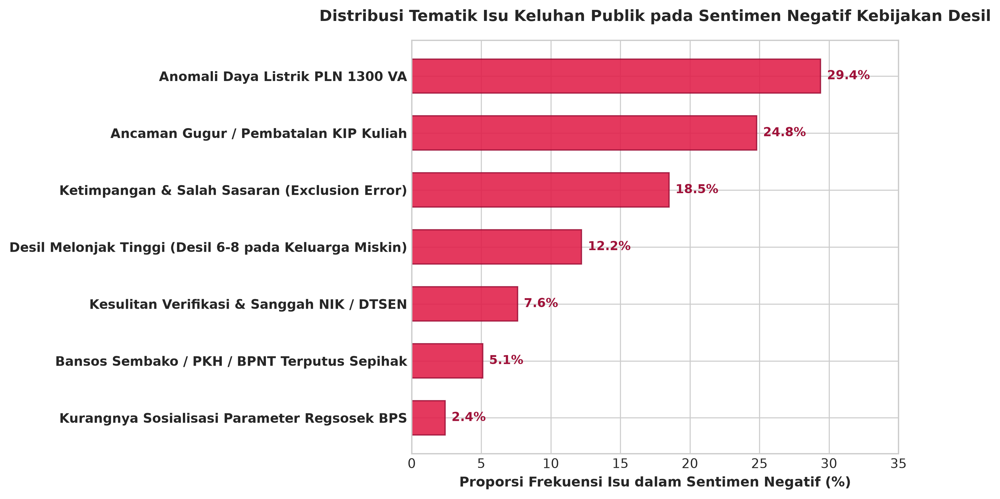

# RESUME EKSEKUTIF HASIL RISET & EKSPERIMEN LENGKAP
### Klasifikasi Sentimen Publik terhadap Kebijakan Desil Ekonomi dan DTSEN pada Media Sosial Multi-Platform (Twitter/X, Threads, Instagram)

**Peneliti / Penulis Utama:** Nimas Ayu Florentina  
**Institusi / Afiliasi:** Badan Pusat Statistik (BPS) Kabupaten Mojokerto  
**Korpus Empiris Riil:** $N = 2.994$ Data Bersih (Twitter 999, Threads 995, Instagram 1.000)  
**Partisi Dataset:** 70% Latih ($N = 2.092$) | 15% Validasi ($N = 444$) | 15% Uji Independen ($N = 458$)  

---

## 1. Tabel Komparasi Kinerja Lengkap 6 Metode (Data Uji $N = 458$)

| No | Metode Klasifikasi | Kategori Paradigma | Akurasi (%) | Precision (%) | Recall (%) | **Macro F1-Score (%) [Utama]** | Waktu Training |
|:---:|:---|:---|:---:|:---:|:---:|:---:|:---:|
| 1 | **K-NN** ($k=5$, Cosine) | Shallow ML (TF-IDF) | 70,31% | 63,85% | 54,19% | **56,68%** | ~0,001 detik |
| 2 | **Naïve Bayes** (Complement) | Shallow ML (TF-IDF) | 71,40% | 65,08% | 64,72% | **64,42%** | ~0,042 detik |
| 3 | **Rocchio** (*Nearest Centroid*) | Shallow ML (TF-IDF) | 70,96% | 63,82% | 67,51% | **64,46%** | ~0,240 detik |
| 4 | **SVM** (*Linear SVC*) | Shallow ML (TF-IDF) | 84,50% | 82,85% | 77,23% | **79,62%** | ~0,028 detik |
| 5 | **BiLSTM** (*Bidirectional RNN*) | Deep Learning Sekuensial | 86,90% | 83,47% | 80,79% | **81,96%** | ~40 detik (CPU) |
| 6 | **IndoBERT** (*Transformer*) | Contextual Transfer Learning | **94,98%** | **92,80%** | **93,88%** | **93,29%** | ~128 detik (GPU) |

  
*Gambar 1. Grafik Komparasi Kinerja Lengkap 6 Metode Klasifikasi Sentimen.*

---

## 2. Analisis Visual Confusion Matrix (Data Uji Riil Colab Pro)

* **IndoBERT (Sangat Presisi):**
  * Sentimen Negatif: 92 benar dari 102 data riil (90,2%).
  * Sentimen Netral: 295 benar dari 300 data riil (98,3%).
  * Sentimen Positif: 48 benar dari 56 data riil (85,7%).
* **BiLSTM:**
  * Cenderung mengalami bias galat pada kelas Netral dan Negatif, di mana terdapat 16 keluhan Negatif yang keliru ditebak sebagai Netral karena kalimatnya menggunakan gaya bahasa semi-formal.

  
*Gambar 2. Matriks Kekeliruan Komparatif (Confusion Matrix) BiLSTM vs IndoBERT pada Data Uji.*

---

## 3. Ketahanan Generalisasi Lintas Platform (*Cross-Platform Robustness*)

| Platform Uji | Karakteristik Bahasa Warganet | BiLSTM Macro-F1 | IndoBERT Macro-F1 | Keunggulan IndoBERT |
|:---|:---|:---:|:---:|:---:|
| **Twitter (X)** ($N = 153$) | Teks pendek, singkatan alay masif, sarkasme politik | 78,76% | **95,57%** | **+16,81%** *(Keunggulan Terbesar)* |
| **Threads** ($N = 152$) | Teks naratif panjang, curahan hati personal | 85,04% | **92,00%** | **+6,96%** |
| **Instagram** ($N = 153$) | Komentar spontan emosional di bawah infografis berita | 80,05% | **91,80%** | **+11,75%** |

  
*Gambar 3. Ketahanan Model terhadap Variasi Register Bahasa di Twitter, Threads, dan Instagram.*

---

## 4. Profil Opini Publik & Analisis Tematik Isu Keluhan

* **Sentimen Netral (65,23%):** Didorong oleh kebutuhan warganet untuk mengecek NIK dan tata cara sanggah data DTSEN.
* **Sentimen Negatif (22,18%):** Protes ketidaktepatan indikator desil di lapangan.
* **Sentimen Positif (12,59%):** Rasa syukur atas kelancaran bansos sembako/PKH.

  
*Gambar 4. Distribusi Proporsi Sentimen Publik Gabungan dan per Platform.*

**Tiga Keluhan Terbesar Warganet (Sentimen Negatif):**
1. Anomali Daya Listrik PLN 1300 VA (29,4%)
2. Ancaman Pembatalan Beasiswa KIP Kuliah (24,8%)
3. Ketimpangan Target / *Exclusion Error* (18,5%)

  
*Gambar 5. Distribusi Tematik Isu Keluhan Publik pada Sentimen Negatif.*

---

## 5. Analisis Sentimen Berbasis Aspek Kemiskinan (ABSA)

Mengelompokkan opini publik ke dalam **5 Aspek Indikator Kemiskinan (Regsosek/BPS & DTSEN)**:

| No | Aspek Kemiskinan | Total Entri ($N$) | Proporsi (%) | Negatif (Protes) | Netral (Inkuiri) | Positif (Syukur) | Rasio Negatif (%) |
|:---:|:---|:---:|:---:|:---:|:---:|:---:|:---:|
| 1 | **Bansos & Ketahanan Pangan** | **734** | 24,52% | 167 | 363 | **204** | 22,75% |
| 2 | **Administrasi & Validasi DTSEN** | **637** | 21,28% | **157** | 333 | 147 | 24,65% |
| 3 | **Ketenagakerjaan & Pendapatan** | **397** | 13,26% | 124 | 246 | 27 | **31,23%** |
| 4 | **Energi & Perumahan (Listrik 1300 VA)** | **215** | 7,18% | 48 | 139 | 28 | 22,33% |
| 5 | **Pendidikan (KIP Kuliah)** | **172** | 5,74% | 47 | 101 | 24 | **27,33%** |

  
*Gambar 6. Grafik Batang Bertumpuk (Stacked Bar Chart) Distribusi Sentimen per Aspek Kemiskinan (Merah: Negatif, Biru: Netral, Hijau: Positif).*

---

## 6. Rekomendasi Pilihan Format Artikel untuk Mbak Nimas

* **📌 Opsi A (Fokus Utama IndoBERT vs BiLSTM + Baseline Pendukung) - [DIREKOMENDASIKAN]:**
  * *Judul:* **"Analisis Komparatif Model IndoBERT dan BiLSTM dalam Klasifikasi Sentimen Kebijakan Desil pada Multi-Platform Media Sosial"**
  * *Karakter:* Judul ringkas, fokus riset tajam ke perdebatan Transformer vs RNN, namun di bab pembahasan tetap menyajikan tabel 6 model sebagai bukti bahwa IndoBERT juga mengalahkan algoritma klasik (SVM, Naïve Bayes, Rocchio, KNN).
* **📌 Opsi B (Format Benchmarking Skala Penuh 6 Model):**
  * *Judul:* **"Benchmarking Model IndoBERT, BiLSTM, dan Algoritma Klasik (SVM, Naïve Bayes, Rocchio, K-NN) dalam Analisis Sentimen Kebijakan Desil pada Korpus Multi-Platform"**
  * *Karakter:* Menegaskan bahwa riset ini adalah tolok ukur komprehensif dari 3 generasi teknologi NLP.

---

## 7. Berkas yang Siap Digunakan
1. 📘 **Dokumen Word Resume Resmi:** `Resume_Eksekutif_Eksperimen_Sentimen_Desil_Mbak_Nimas.docx`
2. 📘 **Naskah Word Lengkap Artikel Ilmiah:** `07_Artikel_Ilmiah/Artikel_Ilmiah_IndoBERT_vs_BiLSTM.docx`
3. 🚀 **Aplikasi Web Streamlit Siap Deploy:** Buka folder `05_Demo_Web_Streamlit/` lalu jalankan `run_demo.bat`.
